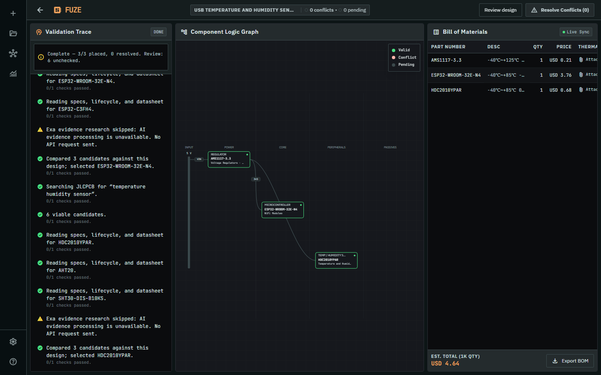
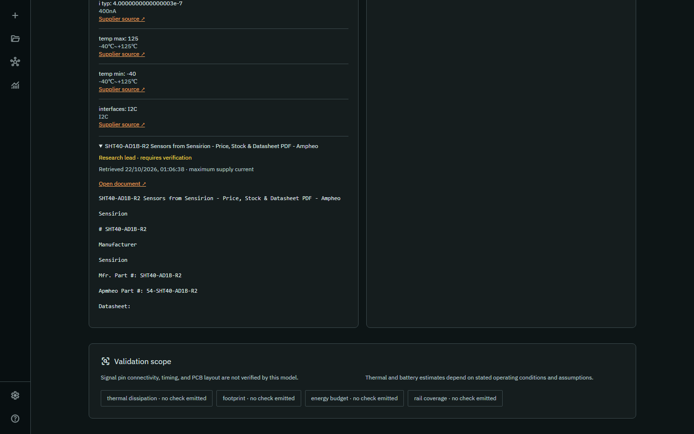
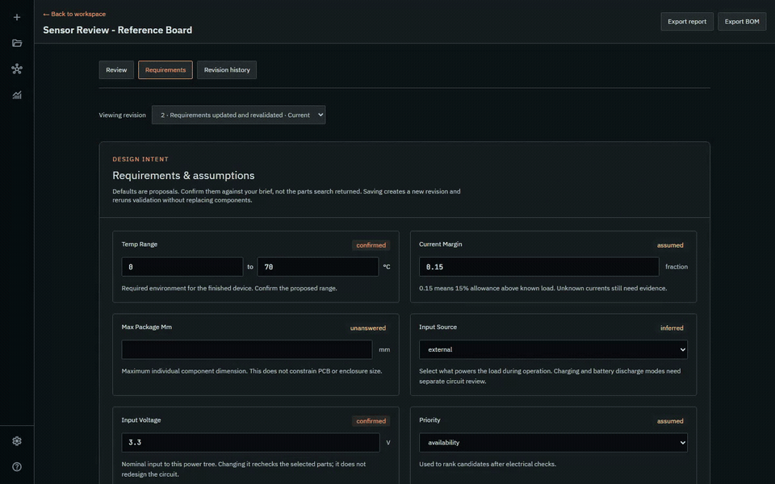
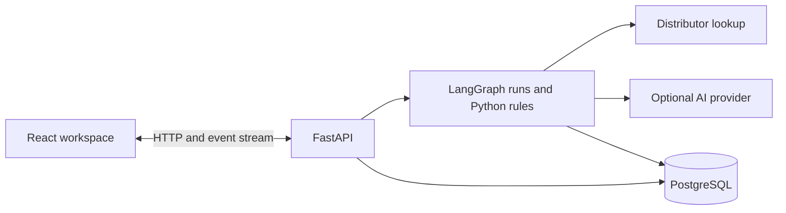

# Continuity

Continuity turns a circuit-board brief or an existing bill of materials into a workspace for sourcing parts, checking electrical constraints, and reviewing repairs. Follow a design from its first description through the board graph, supporting evidence, saved revisions, and an exported BOM.

[Open the app](https://continuity-sc3040.onrender.com) · [Run locally](#start-locally) · [Deployment guide](docs/DEPLOYMENT.md)

## Walk through the app

Start with a brief, follow the checks, inspect the evidence, then refine and save your design. Each preview below opens a video of that part of the workflow.

### 1. Get to know the workspace

Create an account to keep your projects private and saved. The guided walkthrough introduces the three-panel workspace: the component graph, validation trace, and bill of materials. Finish or skip it to reach your projects.

[](docs/media/guided-walkthrough.mp4)

*Watch: account creation and the guided introduction. The walkthrough replays a recorded example with historical parts and prices.*

### 2. Describe a board or bring a BOM

Choose **New project** and describe what you want to build. Include the supply, functions, operating conditions, and production quantity when known. Try `USB temperature and humidity sensor` as a small first project. If you already have a parts list, attach a `.csv` or `.txt` BOM of up to 1 MB and 100 parts; a brief is optional for an uploaded BOM.

As the run progresses, parts appear in the graph and the trace explains sourcing, checks, and proposed repairs. Answer clarification questions when the run needs input. A failed answer submission stays available to retry.

[](docs/media/project-workflow.mp4)

*Watch: a project from its brief through sourcing, checks, export, and reopening. This recording uses the real local app, live distributor lookup, and basic planning with AI disabled.*

The project gets a short name derived from your brief, while the full description remains saved. **Rename project** lets you choose your own name, which carries through the workspace, project list, and memory.

### 3. Inspect the checks and their evidence

After a run completes, open **Review design**. The report shows a visual check summary, questions about your design intent, and evidence tasks grouped by component. Filter **PASS**, **FAIL**, and **UNKNOWN** results or search for a component. Accepted failures retain their original result. Zero failures does not mean the board is ready when checks remain unknown.

Questions ask for missing or unconfirmed requirements, such as battery capacity, runtime, operating temperature and current margin. Values already inferred by the planner are labelled as proposals to confirm. Supplier search cannot decide your intended operating conditions. Missing component measurements stay unknown until supported by evidence; a missing current is never presented as zero draw or 100% available headroom.

The engine checks measurement consistency and power topology before calculating electrical limits. It follows loads through cascaded rails, includes BOM quantities, checks converter direction, and budgets GPIO separately for declared signal nets. Missing measurements, ambiguous connections, and typical-only current figures stay visible as uncertainty. Repairs use the actual board requirements and compare replacements against the whole board, while avoiding components already tried in that run.

When Exa research is enabled, supporting documents include source links, retrieved text, and verification labels. Read those alongside the report's validation limits. Under **Requirements**, confirm the power and signal connections against your circuit, then save to revalidate.

[](docs/media/research-connections.mp4)

*Watch: inspect an actual Exa retrieval, declare an I²C connection, and rerun checks. The reference board uses historical supplier data; the retrieved text stays marked **Requires verification**.*

### 4. Refine, compare, and export

Answer a review question or edit a constraint under **Requirements**, then save. The app creates a revalidated revision and returns to the planning workspace with its graph, BOM and updated checks loaded. A confirmation explains what changed; **Review design** brings you back to the remaining questions. Failed saves retain the entered answer for retry. **Revision history** lets you compare saved versions or restore an earlier design as a new, revalidated revision, also returning to the workspace.

[](docs/media/design-review.mp4)

*Watch: answer a question, return to the revised workspace, change the supply from 3.3 V to 5 V, inspect the new conflict, compare revisions, restore the earlier design, and export its report and BOM.*

Review the selected parts, prices, failures, and unchecked facts before exporting. The graph, current check trace, report, and BOM exports use the same saved design revision. Saving requirements rechecks the existing components; it does not silently launch a new AI sourcing run or replace them. Existing projects remain readable; versioned reports begin with new completed runs.

### 5. Return to your work

Reopen a saved project to restore its board, trace, and BOM. **Memory** connects parts, boards, and earlier findings; **Analytics** summarizes validation outcomes across your designs. The [project workflow video](docs/media/project-workflow.mp4) also follows these steps after export.

Closing the browser does not cancel a server-side run. The event stream reconnects from its saved position, and eligible interrupted runs can recover from checkpoints. You can explicitly cancel a run when you want it to stop. Recovery behavior and its limits are covered in the [verification report](docs/ARCHITECTURE_VALIDATION.md).

All four videos were captured against the local app with PostgreSQL and AI planning disabled. The evidence and revision clips use a reference board that retains its remaining failures and unknowns. [Recording details, chapters, and reproduction](docs/media/README.md).

## Capabilities and limits

Continuity assists design review. Compatibility verdicts come from Python rules; missing specifications remain unchecked, and accepted failures remain visible. Exa retrieves supporting documents, while numeric checks require independently parsed source measurements. A completed run is not a manufacturing certification.

Fresh sourcing needs internet access, and supplier availability and prices can change after a run. The recordings identify historical data where it is used. The supported deployment uses one backend worker; load testing and multi-replica operation are outside the current verification.

## Start locally

Install Docker Desktop, then run from the repository root:

```sh
docker compose up --build
```

Open **http://localhost:8000**. This starts the app and a persistent local PostgreSQL database. Sign up to save projects. Compose credentials are for local development only. AI is disabled by default; no API key is needed to start.

To stop the local services while keeping the database volume, run `docker compose down`.

For development without the app container, see [backend setup](backend/README.md) and [frontend setup](frontend/README.md). Python 3.13 and Node 24 are the reference runtimes. Without `DATABASE_URL`, the app provides a temporary, single-user workspace without accounts or saved projects; restarting loses its data. Production refuses to start without a database.

## AI options

The Python rule engine makes the compatibility decisions. Optional AI plans functional blocks, classifies ambiguous component roles, proposes repairs, and interprets clarification answers. Numeric measurements and interfaces come from parsed supplier data. The app uses an OpenAI-compatible client protocol; that does not mean it calls OpenAI.

The configured model (Groq by default for hosting) can suggest a repair, and Exa can retrieve supporting documents or help discover alternatives. The deterministic engine checks the resulting parts and connections. Its checks still run when the model is unavailable; basic planning remains limited and needs review. Changing the AI provider later does not replace the electrical rules.

| Mode | Configuration | API key |
| --- | --- | --- |
| Basic rules | `CONTINUITY_LLM_PROVIDER=disabled` | None |
| Local Ollama | `CONTINUITY_LLM_PROVIDER=ollama` | None; download a model locally |
| Groq GPT-OSS 120B | `CONTINUITY_LLM_PROVIDER=groq`, `GROQ_API_KEY` | Required; Free Plan quotas apply |
| Gemini 3.8 Flash | `CONTINUITY_LLM_PROVIDER=gemini`, `GEMINI_API_KEY` | Required; provider quotas apply |
| Existing Z.ai setup | `CONTINUITY_LLM_PROVIDER=zai`, `ZAI_API_KEY` | Required |
| Compatible endpoint | `custom`, base URL, model, generic key | Provider-dependent |

For a local AI server, create the tested Qwen 2.5 7B configuration (about a 4.7 GB download, with an 8192-token context):

```sh
ollama pull qwen2.5:7b
ollama create continuity-local -f backend/Modelfile
```

Set `CONTINUITY_LLM_PROVIDER=ollama` in `backend/.env` when running Python directly. For the Docker app, set it in the root `.env` together with `CONTINUITY_LLM_BASE_URL=http://host.docker.internal:11434/v1`. Run Ollama on the host and allow the container to reach it. Do not try to run a model inside the free Render container.

For hosted AI, configure the provider and key as server environment variables. Never put secrets in `VITE_*`, source files, or the browser. With no configured key, `auto` selects basic planning. It recognizes a limited set of functions and parses explicit measurements; missing facts remain unchecked.

Groq defaults to `openai/gpt-oss-120b` at `https://api.groq.com/openai/v1`, using JSON output and low reasoning effort. The [published Free Plan limits](https://console.groq.com/docs/rate-limits) include 30 requests/minute, 1,000/day, 8,000 tokens/minute and 200,000/day for this model. Your Groq account's plan determines billing; selecting the model does not force free billing on a paid account. A board run makes multiple model calls. Short provider cooldowns are respected; exhausted quotas still trigger the labelled basic fallback. See [the Render switch instructions](docs/DEPLOYMENT.md#switch-the-existing-render-service-to-groq).

Gemini defaults to `gemini-3.8-flash` through [Google's OpenAI-compatible endpoint](https://ai.google.dev/gemini-api/docs/openai). `CONTINUITY_LLM_MODEL` and `CONTINUITY_LLM_BASE_URL` override those defaults; existing Render overrides must be updated or removed when upgrading. `/api/runtime` shows the selected configuration, not whether Google has accepted a request. See [deployment verification](docs/DEPLOYMENT.md#verify-the-deployed-service) for the hosted checks.

### Exa research

Add `EXA_API_KEY` to **`backend/.env` for direct Python development** and **Render → Environment for hosting**. For Docker Compose, use the root `.env`. Groq and Exa serve different purposes: Groq handles planning, interpretation and repair proposals; Exa searches the web and retrieves documents. They have separate keys and configuration. Other supported model providers can replace Groq without changing Exa.

Exa uses native Search and Contents endpoints following the [build-with-exa skill](https://github.com/exa-labs/agent-skills/tree/main/skills/build-with-exa). The engine compares up to three resolved candidates against the same design, then researches missing evidence for the selected candidate. Known datasheet URLs use Contents first; missing documents use Search. Exact part-number matching reduces evidence from a different variant. At most two distinct alternative-discovery queries per execution leave more of the shared budget for component evidence. Retrieved documents include URLs, timestamps and hashes and remain unverified; snippets cannot introduce numeric facts.

Defaults are six Exa requests per run and a $0.12 **estimated** request budget, persisted across retries. Set `CONTINUITY_RESEARCH_MAX_CALLS`, `CONTINUITY_RESEARCH_BUDGET_USD`, or `CONTINUITY_RESEARCH_ENABLED=0` to control usage. Provider charges and account quotas remain authoritative. `/api/runtime` reports research configuration separately from its last request status.

### Keeping AI calls useful and bounded

The planner uses a versioned contract and [Groq strict structured output](https://console.groq.com/docs/structured-outputs) for the supported GPT-OSS models. Local validation checks referenced slots, rails and explicitly requested buttons, indicators, buzzer and charging functions. Battery-powered operation is preserved separately from USB charging; unstated battery capacity is left unanswered. These checks improve consistency but do not establish schematic correctness.

Known supplier categories skip unnecessary role-classification calls. Identical model requests share one result within an execution, and an exhausted provider quota stops repeated calls for the remaining stages. `CONTINUITY_LLM_MAX_CALLS=40` and `CONTINUITY_LLM_TOKEN_BUDGET=120000` bound each execution, including retries. Token accounting reserves estimated input plus maximum output before a request and uses actual reported usage on success. These are application limits, not a dollar billing guarantee; a restarted execution gets a fresh LLM allowance. Saved stages and Exa reservations remain durable.

[Groq setup](https://console.groq.com/docs/quickstart), [Ollama compatibility](https://docs.ollama.com/api/openai-compatibility), [xAI requirements](https://docs.x.ai/developers/quickstart). Grok is not a keyless free API.

## Hosting

The deployment target is **one Render Free Docker web service plus Neon Free PostgreSQL**. The frontend and `/api` share one origin, simplifying sessions and deployment. See the complete [deployment guide](docs/DEPLOYMENT.md). `render.yaml` is a deployable Blueprint; it is not evidence that this revision is already live.

1. In your Neon project, click **Connect**, select the branch and database you want to use, and disable **Connection pooling** to copy the direct PostgreSQL URL with its SSL parameters.
2. In Render, choose **New → Blueprint**, connect `Armaan-king/Continuity-SC3040`, select Git branch `main`, and use `render.yaml`.
3. Supply the Neon URL as Render's secret `DATABASE_URL`, then deploy. The Dockerfile builds the frontend and starts the backend; startup applies database migrations.
4. Open the URL assigned by Render. `/api/ready` should report `{"status":"ready","persistence":"postgres"}`. Register, save a project, and reload it to verify persistence.

**Neon project names and IDs are different.** A value passed to the CLI as `--project-id` is a Neon identifier, not the display name you must find or create. Use a project visible in your own account and organization. Its database branch need not be named `production`, and it is independent of the GitHub branch `main`. This app only needs `DATABASE_URL`; no project or organization ID is hard-coded.

Free services have cold starts and quotas. Render's local filesystem is ephemeral; accounts, projects, events, findings, and graph checkpoints belong in PostgreSQL. Part lookup caches can be recreated.

## Architecture and database



The top-level layout is unchanged: `frontend/`, `backend/`, `docs/`, and the existing SWE deliverables remain in place. See [architecture and data model](docs/ARCHITECTURE.md) for component boundaries, tables, execution leases, recovery, migrations, and limitations.

Database changes are ordered, checksum-checked SQL migrations. New deployments and existing schemas are upgraded under a PostgreSQL advisory lock. Never modify an applied migration; add the next numbered file.

## Verification

```sh
python -m pytest backend/tests
npm --prefix frontend run lint
npm --prefix frontend run build
npm --prefix frontend run test:e2e
```

Use the backend virtual environment's Python. Set `CONTINUITY_TEST_DB` to a disposable PostgreSQL database to include integration tests. The store tests truncate their test tables. Browser tests need a separate disposable `E2E_DATABASE_URL`; they seed a known account. See the [review and provider verification report](docs/REVIEW_VALIDATION.md) for the latest results and the [original validation report](docs/VALIDATION.md) for earlier checks. GitHub Actions repeats backend, database, frontend, and Chromium checks.

The [review and provider verification](docs/REVIEW_VALIDATION.md) records **897 passing backend tests**, **5 optional external-service skips**, **28 passing browser tests**, passing lint/build, and bounded live Groq/Exa checks. It covers unknown questions, actual saved revisions and return navigation, mobile review, schema-constrained planning and request budgets. The final live bicycle-alarm plan preserved all seven requested functions in one Groq call; the Exa check used two requests. These checks do not establish hardware correctness.

The earlier [engine verification](docs/ENGINE_VALIDATION.md) records **873 passing backend tests**, including **40 new engine regression cases**, and **26 passing browser tests** for the deterministic rule upgrade.

The [architecture and Exa verification](docs/ARCHITECTURE_VALIDATION.md) covers **830 distinct passing backend tests** across the full and final targeted runs, **5 optional external-service skips**, and **26 passing browser tests**. Live Exa Search and Contents also passed. Earlier smoke runs exercised real parts lookup and local Ollama inference. These are dated results, not a claim that external services always succeed. [Review recording checks](docs/media/README.md#review-feature-verification) and [original workflow recording checks](docs/media/README.md#verification) document the README videos separately.

The [consistency verification](docs/CONSISTENCY_VALIDATION.md) records earlier checks for project naming, clarification retries, saved boards, and BOM replacement/export. To reproduce the opt-in live research check, run `python tools/check_research.py` from `backend`; it makes at most one Search and one Contents request.

The [Groq verification](docs/GROQ_VALIDATION.md) records successful live JSON extraction and board planning with GPT-OSS 120B, 150 targeted backend tests, and the landing-page check after removing the old embedded hackathon video. The provider's Free Plan eligibility and the account's actual billing plan are separate; test success does not establish the latter.

## License and attribution

[MIT](LICENSE). Existing copyright notices and the original project's assets and engineering documents are retained. Historical plans in `docs/` and the SWE submission folders describe earlier versions; this README and the architecture/deployment guides describe the current implementation.
