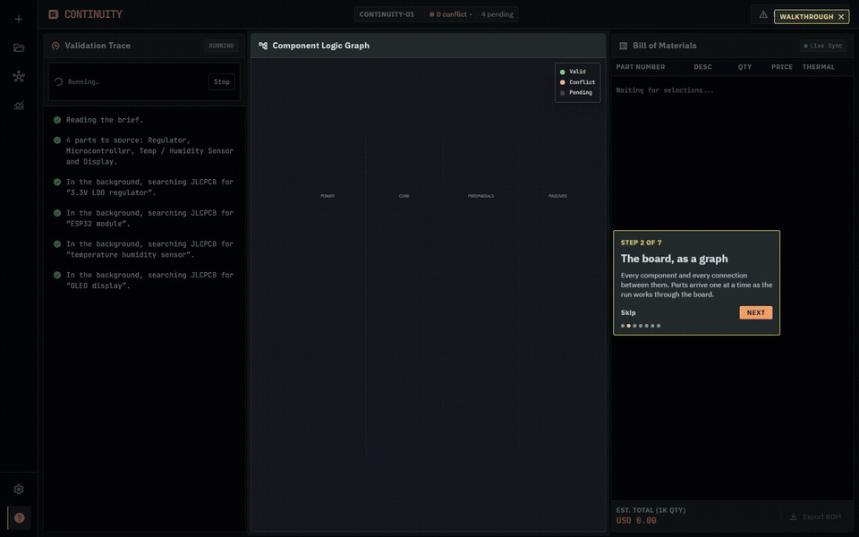

# Continuity

Describe a circuit board or upload a bill of materials, inspect candidate parts, and follow electrical checks and proposed repairs in a graph workspace. The existing React interface is preserved.

Continuity is a design-assistance application. A completed run can still contain unchecked specifications or accepted warnings; consult the evidence shown for each rule before using a board.



## Start locally

Install Docker Desktop, then run from the repository root:

```sh
docker compose up --build
```

Open **http://localhost:8000**. This starts the app and a persistent local PostgreSQL database. Sign up to save projects. Compose credentials are for local development only. AI is disabled by default; no API key is needed to start.

For development without Docker, see [backend setup](backend/README.md) and [frontend setup](frontend/README.md). Python 3.13 and Node 24 are the reference runtimes. Without `DATABASE_URL`, the app provides a temporary, single-user workspace; restarting loses its data. Production refuses to start without a database.

## What works

- Account registration, login/logout, private projects, and project deletion.
- Natural-language briefs and CSV/text BOM input (up to 100 parts).
- Distributor searches, source-backed specifications, deterministic validation, repair loops, and clarification questions.
- Board and BOM restoration, CSV export, recorded findings, and validation analytics.
- Runs that continue across browser disconnections, cursor-based event replay, explicit cancellation, and checkpoint recovery after interrupted execution.
- A clearly identified recorded walkthrough for exploring the interface.

An external parts service is still required for fresh sourcing. Recorded fixtures and the walkthrough are historical data, not current inventory or fresh AI output.

## AI options

The Python rule engine makes the compatibility decisions. Optional AI plans functional blocks, interprets specifications, proposes repairs, and interprets clarification answers. The app uses an OpenAI-compatible client protocol; that does not mean it calls OpenAI.

| Mode | Configuration | API key |
| --- | --- | --- |
| Basic rules | `CONTINUITY_LLM_PROVIDER=disabled` | None |
| Local Ollama | `CONTINUITY_LLM_PROVIDER=ollama` | None; download a model locally |
| Groq | `CONTINUITY_LLM_PROVIDER=groq`, `GROQ_API_KEY` | Required; free developer tier has limits |
| Gemini | `CONTINUITY_LLM_PROVIDER=gemini`, `GEMINI_API_KEY` | Required; availability and quotas vary |
| Existing Z.ai setup | `CONTINUITY_LLM_PROVIDER=zai`, `ZAI_API_KEY` | Required |
| Compatible endpoint | `custom`, base URL, model, generic key | Provider-dependent |

For a local AI server, create the tested Qwen 2.5 7B configuration (about a 4.7 GB download, with an 8192-token context):

```sh
ollama create continuity-local -f backend/Modelfile
```

Set `CONTINUITY_LLM_PROVIDER=ollama` in `backend/.env` when running Python directly. For the Docker app, set it in the root `.env` together with `CONTINUITY_LLM_BASE_URL=http://host.docker.internal:11434/v1`. Run Ollama on the host and allow the container to reach it. Do not try to run a model inside the free Render container.

For hosted AI, configure the provider and key as server environment variables. Never put secrets in `VITE_*`, source files, or the browser. With no configured key, `auto` selects basic planning. It recognizes a limited set of functions and parses explicit measurements; missing facts remain unchecked.

[Groq setup](https://console.groq.com/docs/quickstart), [Ollama compatibility](https://docs.ollama.com/api/openai-compatibility), [xAI requirements](https://docs.x.ai/developers/quickstart). Grok is not a keyless free API.

## Hosting

The deployment target is **one Render Free Docker web service plus Neon Free PostgreSQL**. The frontend and `/api` share one origin, simplifying sessions and deployment. See the complete [deployment guide](docs/DEPLOYMENT.md). `render.yaml` is a deployable Blueprint; it is not evidence that this revision is already live.

Free services have cold starts and quotas. Render's local filesystem is ephemeral; accounts, projects, events, findings, and graph checkpoints belong in PostgreSQL. Part lookup caches can be recreated.

## Architecture and database

The top-level layout is unchanged: `frontend/`, `backend/`, `docs/`, and the existing SWE deliverables remain in place. See [architecture and data model](docs/ARCHITECTURE.md) for component boundaries, tables, execution leases, recovery, migrations, and limitations.

Database changes are ordered, checksum-checked SQL migrations. New deployments and existing schemas are upgraded under a PostgreSQL advisory lock. Never modify an applied migration; add the next numbered file.

## Verification

```sh
python -m pytest backend/tests
npm --prefix frontend run lint
npm --prefix frontend run build
npm --prefix frontend run test:e2e
```

Use the backend virtual environment's Python. Set `CONTINUITY_TEST_DB` to a disposable PostgreSQL database to include integration tests. The store tests truncate their test tables. Browser tests need a separate disposable `E2E_DATABASE_URL`; they seed a known account. See [validation report](docs/VALIDATION.md) for the results produced during this update. GitHub Actions repeats backend, database, frontend, and Chromium checks.

## License and attribution

[MIT](LICENSE). Existing copyright notices and the original project's assets and engineering documents are retained. Historical plans in `docs/` and the SWE submission folders describe earlier versions; this README and the architecture/deployment guides describe the current implementation.
