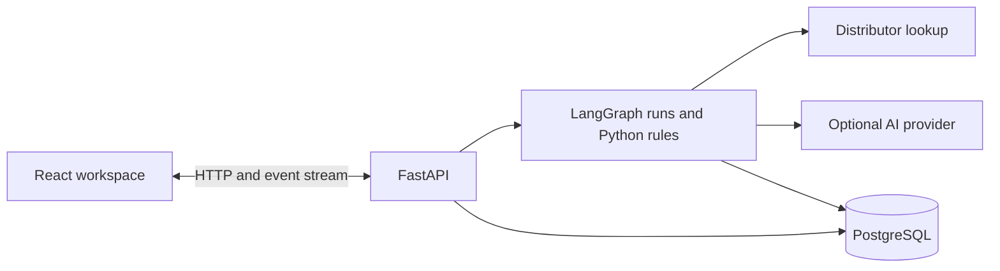

# Continuity

Continuity turns a circuit-board brief or an existing bill of materials into a workspace for sourcing parts, inspecting electrical checks, and reviewing repairs. It brings the board graph, validation trace, and BOM together, with saved projects, findings, and analytics.

Continuity is a design-assistance application. A completed run can still contain unchecked specifications or accepted warnings; consult the evidence shown for each rule before using a board.

The workspace now includes **Review design**: a validation report, editable requirements, connection confirmation, and revision comparison/restore. The graph, report and BOM exports read the same saved design revision. Optional Exa research finds supporting documents and additional candidates; numeric checks still require independently parsed source measurements.

## See the current app

[](docs/media/design-review.mp4)

**Design review and revision history** — change a requirement, rerun checks, compare versions, restore an earlier design, and export the same revision as a report and BOM.

[](docs/media/research-connections.mp4)

**Exa evidence and connection review** — inspect retrieved source text and verification limits, declare an I²C connection, confirm the reference power connections, and revalidate. Click either preview to watch its full video.

The new clips use the real local app and PostgreSQL with a labeled reference board, historical supplier fixtures, and an actual Exa response retrieved for the recording. They demonstrate review and revalidation; AI planning is disabled. Research remains marked **Requires verification**, and the reference board's remaining failures and unknowns stay visible.

[](docs/media/guided-walkthrough.mp4)

| Recording | What it shows | Data and AI mode |
| --- | --- | --- |
| [Design review and revisions](docs/media/design-review.mp4) | Validation report, requirement edit, new voltage conflict, comparison, restore, report/BOM export, and workspace reload | Real local app and PostgreSQL; reference board with recorded supplier data; AI planning disabled |
| [Exa evidence and connections](docs/media/research-connections.mp4) | Source text and verification labels, validation limits, power confirmation, and per-connection protocol checks | Actual Exa retrieval saved before capture; the same reference board; no new model response |
| [Project workflow](docs/media/project-workflow.mp4) | Sign in, create a board, source parts, inspect checks, export CSV, reopen the saved board, and review analytics and memory | Real local app and PostgreSQL; live distributor lookup; basic planning with AI disabled |
| [Guided walkthrough](docs/media/guided-walkthrough.mp4) | Create an account and follow the seven-step introduction to the graph, trace, conflict evidence, BOM, and memory | The app's built-in recorded example; historical parts and prices |

The first two clips show the new review features; the original project workflow and guided walkthrough remain available below them. The three-panel workspace is retained. Automatic recovery is covered in the [verification report](docs/ARCHITECTURE_VALIDATION.md), rather than depicted as a visible feature in these clips. [Recording details, chapters, and reproduction](docs/media/README.md).


## Use the app

1. **Create an account.** With PostgreSQL configured, your projects are private to your account. New accounts enter the guided walkthrough; finish or skip it to reach your projects.
2. **Start a project.** Use the **New project** button and describe the board, including its supply, functions, operating conditions, and production quantity when known. A small first example is `USB temperature and humidity sensor`.
3. **Or attach a BOM.** The brief screen accepts `.csv` and `.txt` files up to 1 MB, with at most 100 parts. You can attach a BOM without a brief.
4. **Follow the validation trace.** Parts arrive in the graph as sourcing and checks proceed. Open the findings and evidence; answer clarification questions when the run needs input.
5. **Review and export.** Inspect selected parts, prices, failures, warnings, and unchecked facts before choosing **Export BOM**. Completion describes the workflow, not a guarantee that a board is ready to manufacture.
6. **Return to your work.** Reopen a project to restore its board, trace, and BOM. **Memory** connects parts, boards, and earlier findings; **Analytics** summarizes validation outcomes across your designs.

Project names are derived from the subject of the brief: `I want to make a small temperature monitor with an OLED` becomes **Temperature Monitor**. The full brief remains saved, and names you choose through **Rename project** are preserved. The workspace, project list, and memory use the same saved name.

A completed run may still **need review**. Its summary distinguishes failed checks, warnings, and unchecked facts. Unresolved conflicts remain visible after completion and when you reopen the board, including uploaded BOMs. If sending a clarification answer fails, the question remains available to retry.

Closing a browser view does not cancel its server-side run. The event stream reconnects using its saved cursor; you can explicitly cancel a run or recover an eligible checkpoint after interrupted execution. Fresh sourcing needs internet access to the distributor.

After completing a run, open **Review design**. The report distinguishes PASS, FAIL and UNKNOWN and retains accepted failures. Under **Requirements**, edit constraints or confirm power/signal connections against your circuit, then save to revalidate. **Revision history** compares saved versions and restores an earlier design as a new revision. Existing projects remain readable; versioned reports begin with new completed runs.

## Start locally

Install Docker Desktop, then run from the repository root:

```sh
docker compose up --build
```

Open **http://localhost:8000**. This starts the app and a persistent local PostgreSQL database. Sign up to save projects. Compose credentials are for local development only. AI is disabled by default; no API key is needed to start.

To stop the local services while keeping the database volume, run `docker compose down`.

For development without the app container, see [backend setup](backend/README.md) and [frontend setup](frontend/README.md). Python 3.13 and Node 24 are the reference runtimes. Without `DATABASE_URL`, the app provides a temporary, single-user workspace without accounts or saved projects; restarting loses its data. Production refuses to start without a database.

## Capabilities and limits

- Account registration, login/logout, private projects, and project deletion.
- Natural-language briefs and CSV/text BOM input (up to 100 parts).
- Distributor searches, source-backed specifications, deterministic validation, repair loops, and clarification questions.
- Board and BOM restoration, CSV export, recorded findings, and validation analytics.
- Runs that continue across browser disconnections, event replay without duplicates, explicit cancellation, and eligible checkpoint recovery after interrupted execution.
- A clearly identified recorded walkthrough for exploring the interface.

Compatibility verdicts come from Python rules. Missing specifications remain unchecked. Supplier availability and prices can change after a run, and accepted warnings remain warnings. The walkthrough and test fixtures are historical examples, not fresh sourcing or AI output. The supported deployment uses one backend worker; load testing and multi-replica operation are outside the current verification.

## AI options

The Python rule engine makes the compatibility decisions. Optional AI plans functional blocks, interprets specifications, proposes repairs, and interprets clarification answers. The app uses an OpenAI-compatible client protocol; that does not mean it calls OpenAI.

| Mode | Configuration | API key |
| --- | --- | --- |
| Basic rules | `CONTINUITY_LLM_PROVIDER=disabled` | None |
| Local Ollama | `CONTINUITY_LLM_PROVIDER=ollama` | None; download a model locally |
| Groq | `CONTINUITY_LLM_PROVIDER=groq`, `GROQ_API_KEY` | Required; provider quotas apply |
| Gemini | `CONTINUITY_LLM_PROVIDER=gemini`, `GEMINI_API_KEY` | Required; provider quotas apply |
| Existing Z.ai setup | `CONTINUITY_LLM_PROVIDER=zai`, `ZAI_API_KEY` | Required |
| Compatible endpoint | `custom`, base URL, model, generic key | Provider-dependent |

For a local AI server, create the tested Qwen 2.5 7B configuration (about a 4.7 GB download, with an 8192-token context):

```sh
ollama pull qwen2.5:7b
ollama create continuity-local -f backend/Modelfile
```

Set `CONTINUITY_LLM_PROVIDER=ollama` in `backend/.env` when running Python directly. For the Docker app, set it in the root `.env` together with `CONTINUITY_LLM_BASE_URL=http://host.docker.internal:11434/v1`. Run Ollama on the host and allow the container to reach it. Do not try to run a model inside the free Render container.

For hosted AI, configure the provider and key as server environment variables. Never put secrets in `VITE_*`, source files, or the browser. With no configured key, `auto` selects basic planning. It recognizes a limited set of functions and parses explicit measurements; missing facts remain unchecked.

### Exa research

Add `EXA_API_KEY` to **`backend/.env` for direct Python development** and **Render → Environment for hosting**. For Docker Compose, use the root `.env`. Gemini and Exa serve different purposes: Gemini handles planning, interpretation and repair proposals; Exa searches the web and retrieves documents. Keep `CONTINUITY_LLM_PROVIDER=gemini` and `GEMINI_API_KEY` for your existing Gemini setup.

Exa uses native Search and Contents endpoints following the [build-with-exa skill](https://github.com/exa-labs/agent-skills/tree/main/skills/build-with-exa). Research runs when a part lacks evidence or supplier searches yield too few candidates. Retrieved documents include URLs, timestamps and hashes and remain unverified until reviewed; snippets cannot introduce numeric facts. The engine compares up to three resolved candidates against the same design before selecting one.

Defaults are six Exa requests per run and a $0.12 **estimated** request budget, persisted across retries. Set `CONTINUITY_RESEARCH_MAX_CALLS`, `CONTINUITY_RESEARCH_BUDGET_USD`, or `CONTINUITY_RESEARCH_ENABLED=0` to control usage. Provider charges and account quotas remain authoritative. `/api/runtime` reports research configuration separately from its last request status.

[Groq setup](https://console.groq.com/docs/quickstart), [Ollama compatibility](https://docs.ollama.com/api/openai-compatibility), [xAI requirements](https://docs.x.ai/developers/quickstart). Grok is not a keyless free API.

## Hosting

The deployment target is **one Render Free Docker web service plus Neon Free PostgreSQL**. The frontend and `/api` share one origin, simplifying sessions and deployment. See the complete [deployment guide](docs/DEPLOYMENT.md). `render.yaml` is a deployable Blueprint; it is not evidence that this revision is already live.

1. In your Neon project, click **Connect**, select the branch and database you want to use, and disable **Connection pooling** to copy the direct PostgreSQL URL with its SSL parameters.
2. In Render, choose **New → Blueprint**, connect `Armaan-king/Continuity-SC3040`, select Git branch `main`, and use `render.yaml`.
3. Supply the Neon URL as Render's secret `DATABASE_URL`, then deploy. The Dockerfile builds the frontend and starts the backend; startup applies database migrations.
4. Open the URL assigned by Render. `/api/ready` should report `{"status":"ready","persistence":"postgres"}`. Register, save a project, and reload it to verify persistence.

**Neon project names and IDs are different.** A value passed to the CLI as `--project-id` is a Neon identifier, not the display name you must find or create. Use a project visible in your own account and organization. Its database branch need not be named `production`, and it is independent of the GitHub branch `main`. This app only needs `DATABASE_URL`; no project or organization ID is hard-coded.

Free services have cold starts and quotas. Render's local filesystem is ephemeral; accounts, projects, events, findings, and graph checkpoints belong in PostgreSQL. Part lookup caches can be recreated.

## Architecture and database



The top-level layout is unchanged: `frontend/`, `backend/`, `docs/`, and the existing SWE deliverables remain in place. See [architecture and data model](docs/ARCHITECTURE.md) for component boundaries, tables, execution leases, recovery, migrations, and limitations.

Database changes are ordered, checksum-checked SQL migrations. New deployments and existing schemas are upgraded under a PostgreSQL advisory lock. Never modify an applied migration; add the next numbered file.

## Verification

```sh
python -m pytest backend/tests
npm --prefix frontend run lint
npm --prefix frontend run build
npm --prefix frontend run test:e2e
```

Use the backend virtual environment's Python. Set `CONTINUITY_TEST_DB` to a disposable PostgreSQL database to include integration tests. The store tests truncate their test tables. Browser tests need a separate disposable `E2E_DATABASE_URL`; they seed a known account. See the [architecture verification report](docs/ARCHITECTURE_VALIDATION.md) for the latest implementation results and the [original validation report](docs/VALIDATION.md) for earlier checks. GitHub Actions repeats backend, database, frontend, and Chromium checks.

The [architecture and Exa verification](docs/ARCHITECTURE_VALIDATION.md) covers **830 distinct passing backend tests** across the full and final targeted runs, **5 optional external-service skips**, and **26 passing browser tests**. Live Exa Search and Contents also passed. Earlier smoke runs exercised real parts lookup and local Ollama inference. These are dated results, not a claim that external services always succeed. [Review recording checks](docs/media/README.md#review-feature-verification) and [original workflow recording checks](docs/media/README.md#verification) document the README videos separately.

The earlier [consistency update](docs/CONSISTENCY_VALIDATION.md) passed **796 backend tests and 25 browser tests**, with 5 opt-in external-service skips. Its logs cover project naming, preserved custom names, clarification retries, final-board restoration, and BOM replacement/export consistency.

See [architecture and Exa verification](docs/ARCHITECTURE_VALIDATION.md) for the current test results, live Exa smoke check, command output and limitations. The live research check is explicitly opt-in: from `backend`, run `python tools/check_research.py`; it makes at most one Search and one Contents request.

## License and attribution

[MIT](LICENSE). Existing copyright notices and the original project's assets and engineering documents are retained. Historical plans in `docs/` and the SWE submission folders describe earlier versions; this README and the architecture/deployment guides describe the current implementation.
