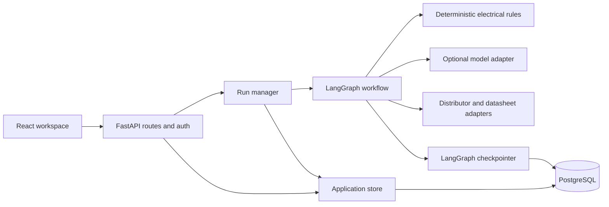

# Architecture and data model

## Boundaries

`continuity/server.py` mounts the API at `/api` and serves the built SPA. `api/app.py` handles request validation and orchestration; `api/execution.py` produces graph/BOM events; `api/runs.py` owns run lifetime and subscriptions. `api/store.py` contains parameterized SQL and ownership-scoped lookups. `settings.py` validates environment settings. The graph, planner, parts adapters, reviewer and deterministic rule engine retain their existing directories.

The browser never receives provider keys. Model output is input to validated application structures; it does not directly decide rule verdicts. The no-key parser accepts explicit, unit-bearing distributor measurements and preserves their provenance. Unsupported measurements stay unknown.

## Data ownership

| Table | Purpose | Key / relationship |
| --- | --- | --- |
| users | Account email, Argon2 password hash, onboarding | `id`; unique normalized email |
| sessions | Revocable sessions with idle and absolute expiry | SHA-256 token hash; owner FK |
| projects | Named private workspaces; generated/manual name provenance | `id`, owner FK |
| threads | Run prompt, status, cursor, BOM, summary, execution lease | `id`; composite project/owner FK |
| run_events | Ordered replayable events including BOM frames | `(thread_id, seq)`; cascade on thread deletion |
| findings | User-visible rule and repair observations | owner/project/thread composite FK |
| part_facts | Intrinsic, sourced facts shared by part number | `(mpn, field)`; never stores board verdicts |
| schema_migrations | Applied application migrations and checksums | migration version |
| checkpoint tables | Graph state and pending interrupts | Managed by LangGraph's PostgreSQL saver |

Project/thread/finding ownership is enforced both in queries and by composite foreign keys. Deleting a project cascades application records and routes also remove its graph checkpoints. Session cookies contain random tokens; the database stores their hashes. Findings are persisted atomically. Historical findings are reloaded into the recorder before a continued run.

## Execution and recovery

A request ID and input fingerprint derive a stable thread ID, so repeated submissions of the same request subscribe to existing work. Each account may hold one active run. Process capacity and a total execution timeout bound resource use.

The run manager consumes the graph independently of HTTP subscribers. Events are persisted before publication. A browser reconnects after its highest sequence number; refreshing a running project replays its events. Explicit cancellation stops execution; leaving the page only closes its subscription.

Question, completion, and error events reach the local subscriber only after producer cleanup and release of the execution lease. This makes an immediately submitted answer admissible and makes a completed board available for retrieval before the browser navigates away. Design and BOM runs emit a final `board` snapshot containing slots, parts, resolved edges, and remaining conflicts. Saved-board retrieval uses that same snapshot; older BOM recordings are reconstructed from their incremental events. Completion summaries separately count failures, warnings, and unchecked facts.

`api/project_names.py` derives bounded titles without an extra model request. Creating the first thread and naming an untitled generated project share a database transaction. Explicit renames mark the title as manual, so later briefs cannot overwrite it. The full original prompt remains on the thread.

A database lease identifies the executing worker. It expires after 45 seconds and renews every 10 seconds. Admission serializes on the account row. Writes from a superseded execution are rejected using its lease token; released or expired leases cannot overwrite a newer run. Status becomes terminal after execution cleanup. Abandoned/error runs with unfinished graph checkpoints can be continued. A hard process failure can re-execute a node since its last graph checkpoint, including external read/model calls; this is not an exactly-once job system. BOM validation has no graph checkpoint and must be restarted if interrupted.

The supported free-host configuration uses one Uvicorn worker. In-memory caches and per-process admission are bounded, but horizontal scaling needs a shared queue and global capacity/rate limiting. Local mode retains recent runs in memory and has no accounts, durable history, or restart recovery. Do not expose local mode as a public multi-user deployment.

## Schema changes

The immutable `schema.sql` is migration 001. Migration 002 adds execution leases, replay sequence checks and ownership constraints. Migration 003 adds project-name provenance and runs a one-time data conversion for untitled projects and conversational names matching the old first-six-words algorithm. Other existing names are retained. All application migrations run in one transaction under an advisory lock. A changed applied SQL file fails startup rather than silently rewriting history. LangGraph manages its own checkpoint schema; both use the same pool.

## Operational limits

Free-host restarts do not preserve Python tasks. PostgreSQL preserves graph checkpoints and events; the UI supports reopening and continuing eligible interrupted runs. Cached part facts are not a substitute for fresh stock/pricing queries. External model and distributor outages can reduce functionality. The recorded walkthrough does not call a live model.

The app provides account registration/login/logout, not email verification, password reset email, organization roles, billing, or a PCB layout/manufacturing workflow. Those are separate product features.
