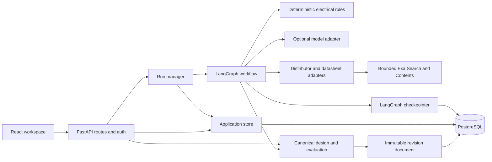

# Architecture and data model

## Boundaries

`continuity/server.py` mounts the API at `/api` and serves the built SPA. `api/app.py` handles request validation and orchestration; `api/execution.py` produces graph/BOM events; `api/runs.py` owns run lifetime and subscriptions. `api/store.py` contains parameterized SQL and ownership-scoped lookups. `settings.py` validates environment settings. The graph, planner, parts adapters, reviewer and deterministic rule engine retain their existing directories.

The browser never receives provider keys. Model output is input to validated application structures; it does not directly decide rule verdicts. The no-key parser accepts explicit, unit-bearing distributor measurements and preserves their provenance. Unsupported measurements stay unknown.

## Data ownership

| Table | Purpose | Key / relationship |
| --- | --- | --- |
| users | Account email, Argon2 password hash, onboarding | `id`; unique normalized email |
| sessions | Revocable sessions with idle and absolute expiry | SHA-256 token hash; owner FK |
| projects | Named private workspaces; generated/manual name provenance | `id`, owner FK |
| threads | Run prompt, status, cursor, BOM, summary, execution lease | `id`; composite project/owner FK |
| run_events | Ordered replayable events including BOM frames | `(thread_id, seq)`; cascade on thread deletion |
| findings | User-visible rule and repair observations | owner/project/thread composite FK |
| part_facts | Intrinsic, sourced facts shared by part number | `(mpn, field)`; never stores board verdicts |
| schema_migrations | Applied application migrations and checksums | migration version |
| checkpoint tables | Graph state and pending interrupts | Managed by LangGraph's PostgreSQL saver |
| design_revisions | Immutable board, requirements, evidence, report, quantities and BOM | owner/project/thread FK; parent revision and content hash |
| run_inputs | Original brief/BOM input, cancellation and recovery count | one record per thread, created with run admission |
| run_stages | Completed expensive work keyed by input digest and stage version | `(thread_id, stage_key)` |
| research_requests | Deduplicated Exa reservations, results and reported cost | `(thread_id, request_key)`; durable per-run budget |

Project/thread/finding ownership is enforced both in queries and by composite foreign keys. Deleting a project cascades application records and routes also remove its graph checkpoints. Session cookies contain random tokens; the database stores their hashes. Findings are persisted atomically. Historical findings are reloaded into the recorder before a continued run.

## Execution and recovery

A request ID and input fingerprint derive a stable thread ID, so repeated submissions of the same request subscribe to existing work. Each account may hold one active run. Process capacity and a total execution timeout bound resource use.

The run manager consumes the graph independently of HTTP subscribers. Events are persisted before publication. A browser reconnects after its highest sequence number; refreshing a running project replays its events. Explicit cancellation stops execution; leaving the page only closes its subscription.

Question, completion, and error events reach the local subscriber only after producer cleanup and release of the execution lease. This makes an immediately submitted answer admissible and makes a completed board available for retrieval before the browser navigates away. Design and BOM runs produce a canonical document via `designs/service.py`. Its revision and final board event commit together before publication. Completed-board retrieval, reports and exports read that revision; legacy runs retain their existing restoration path. Completion summaries separately count failures, warnings, and unchecked facts.

`api/project_names.py` derives bounded titles without an extra model request. Creating the first thread and naming an untitled generated project share a database transaction. Explicit renames mark the title as manual, so later briefs cannot overwrite it. The full original prompt remains on the thread.

A database lease identifies the executing worker. It expires after 45 seconds and renews every 10 seconds. Admission serializes on the account row. Writes from a superseded execution are rejected using its lease token; released or expired leases cannot overwrite a newer run. Status becomes terminal after execution cleanup. Completed normalization and BOM resolution/requirements/rail stages survive restarts through `designs/context.py`. Graph checkpoints retain orchestration state. A 15-second recovery loop resumes eligible abandoned inputs at most twice while the host is awake. Manual continuation supports failed/interrupted BOM runs. Explicit cancellation excludes automatic recovery. A crash before a stage commits can repeat its external calls; this is not an exactly-once job system.

## Revisions and evidence

`designs/service.py` is the shared validation boundary for generated boards, imported BOMs and edits. Documents record schema/ruleset versions, source measurements, requirements and their stated/inferred/assumed/confirmed basis, quantities, findings, decisions and a stable content hash. Reports preserve UNKNOWN outcomes and original accepted failures. A missing rule result is not counted as a pass.

Requirements and connection commands create new revisions and revalidate using the saved component snapshot without a model or network request. Restore creates a revalidated revision rather than deleting history. Commands check ownership, block active runs and reject stale project heads with HTTP 409. Exports include the revision ID. Historical run traces, repair Memory and aggregate Analytics describe the original run observations; the Review report is authoritative for the selected edited revision.

Numeric model output must agree with an independent parser of explicit supplier parameters or admitted manufacturer passages. Research also requires publisher authority, part applicability and verbatim parameter/value support. Provenance naming an existing field is insufficient. Cache identity includes manufacturer, MPN, package, source parameters and parser/prompt versions; old numeric dossier entries cannot bypass this check. Thermal quotes must contain the extracted number and cached thermal facts must match the requested package. This is source validation, not independent measurement of the manufacturer's claim.

Declared signal nets separate controllers and protocols. Connections inferred from a BOM remain unconfirmed until reviewed; supported protocol alone is not physical connectivity. Passing current/thermal/energy checks based only on typical load current become unknown. New waivers bind rule, subject, scope and evidence/detail hash; earlier checkpoint pairs remain readable for compatibility. Requirement edits and restores do not carry waivers forward automatically.

### Deterministic engine, ruleset `2026-10-evidence-5`

`engine/integrity.py` checks finite measurements, valid ranges and quantities, and power topology before arithmetic. It excludes invalid measurements from an evaluation copy while retaining the original evidence in the saved document. Duplicate consumers, missing sources, multiple supplies and power cycles produce explicit findings. Multi-output sources contribute all loads to upstream demand, but their individual output ratings remain unverified.

`engine/draw.py` carries known partial loads through cascaded supplies, so an unknown load cannot erase an already provable overload. It converts switching-stage output power to input current and uses the declared component quantity once per load. An assumed conversion efficiency cannot by itself establish an input-current failure: the ideal-conversion lower bound must also exceed capacity. Otherwise the input budget is UNKNOWN. Typical-only load uncertainty propagates through upstream checks and battery estimates.

`engine/signals.py` evaluates explicitly declared nets: controller presence, protocol capability, role mismatch, UART fan-out and GPIO demand per independent bus. Shared I²C devices share two signal pins; separate buses each consume two. Multiple controllers without assignments, unconfirmed nets, missing interface data and grouped component instances remain unchecked. Generated boards without declared signal nets retain the existing capability checks; those are not proof of physical wiring.

The capability checks also keep missing controller interfaces unknown, including during candidate ranking. Missing supplier data cannot establish that a controller lacks I²C. The specification parser recognizes explicit IIC, I²C and TWI aliases using the engine's shared bus vocabulary, preserves the original parameter as evidence, and excludes negated or optional capabilities. Parser versions participate in both part-cache and durable normalization-stage identities.

[Interface regression diagnosis and verification](INTERFACE_VALIDATION.md) records the manufacturer evidence, test results and deployment limits.

`engine/repairs.py` derives voltage, output-current margin, temperature range and converter-direction constraints from the current board. The graph still fences AI and fallback proposals through the same repair policy. Constrained searches compare up to three candidates against all board checks before placement, prioritize hard failures and uncertainty ahead of commercial preferences, and retain previously tried identities across checkpoints. Exhausted options escalate for a user decision.

Slot quantities are explicit in new revision documents. Reading an older BOM revision converts its repeated-member representation using the saved quantities, preventing double counting. Existing immutable revisions are not rewritten. The ruleset version changes, but no SQL migration or hosting-variable change is required.

## Research and selection

Exa is an optional adapter in `parts/research.py`, configured with server-only `EXA_API_KEY`. It uses native `/search` (`auto`, highlights) for discovery and `/contents` (bounded text) to inspect source context. It does not invent domain/category filters. Public HTTPS URLs, per-URL retrieval statuses, response size and timeouts are checked. Retrieved text remains untrusted source data, with its retrieval time, content hash and source URL preserved.

Missing-evidence research attaches reviewable documents. `parts/evidence.py` batches up to eight extraction claims from two documents, with at most 6,000 input characters per document and 2,048 output tokens. A maintained manufacturer/domain mapping establishes eligible publishers after retrieval; the model cannot declare its own source authoritative. Exact ordering-code evidence is required for numeric facts, with directly associated quoted parameter/value pairs. Supplier-linked manufacturer family documents may supply positive interface capabilities only. Negation, optional features, unsupported protocols, absolute maximum/storage ratings, conditional measurements and unparseable values do not become operating facts.

Accepted facts carry source URL, passage, retrieval time, document hash, identity basis, validator version and supporting sources. Contradictory numeric values invalidate the affected range; explicit manufacturer interface denials invalidate a conflicting positive list. Both produce UNKNOWN source-integrity findings. Raw supplier fields remain preserved. Current and efficiency claims remain review-only because the model does not yet match operating modes and load-dependent conditions. Evidence cards distinguish accepted, conflicting and review-only claims; reports, exports and saved revisions carry the same provenance.

Alternative discovery resolves literal identifiers from retrieved text back through the supplier catalogue. At most three shortlisted candidates are checked against the same board. The leading candidate is researched, revalidated and reranked; at most one fallback is then researched. Failures and unknowns precede commercial preferences. Unknown source mappings and ambiguous family documents remain leads rather than silently supplying facts.

Request reservations and cached results are durable per run. Defaults allow six requests with a $0.12 estimated budget and a $0.02 reservation per request. Actual reported costs are recorded; provider pricing/account limits govern actual billing. Reservations survive a crash and are not blindly retried. Missing keys or retrieval failures preserve ordinary supplier/rules behavior. `/runtime` distinguishes configured research from the last actual request result.

Extraction defaults to three parts per execution and one model attempt per part, with no automatic extraction retry. Paid retrieval is skipped when the model is unavailable or its call/token/extraction allowance is exhausted. Completed part research is looked up before those guards, so reaching a limit never hides already purchased facts. Execution caches coalesce repeated work; durable stages retain completed parts and extraction results across recovery. No global cache contains user briefs. See [source-fact verification](SOURCE_FACTS_VALIDATION.md).

The supported free-host configuration uses one Uvicorn worker. In-memory caches and per-process admission are bounded, but horizontal scaling needs a shared queue and global capacity/rate limiting. Local mode retains recent runs in memory and has no accounts, durable history, or restart recovery. Do not expose local mode as a public multi-user deployment.

## Schema changes

The immutable `schema.sql` is migration 001. Migration 002 adds execution leases, replay sequence checks and ownership constraints. Migration 003 adds project-name provenance and converts known legacy generated names. Migration 004 adds immutable design revisions, durable stages/inputs and research reservations without removing existing data. All application migrations run in one transaction under an advisory lock. A changed applied SQL file fails startup rather than silently rewriting history. LangGraph manages its own checkpoint schema; both use the same pool.

## Operational limits

Free-host restarts do not preserve Python tasks. PostgreSQL preserves graph checkpoints and events; the UI supports reopening and continuing eligible interrupted runs. Cached part facts are not a substitute for fresh stock/pricing queries. External model and distributor outages can reduce functionality. The recorded walkthrough does not call a live model.

The app provides account registration/login/logout, not email verification, password reset email, organization roles, billing, or a PCB layout/manufacturing workflow. Those are separate product features.
